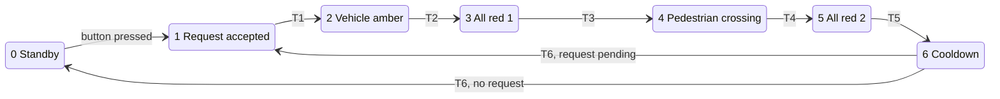

# Pelican Crossing – Siemens S7-1200 PLC Program (SCL)

PLC program for a **pelican crossing** (pedestrian-activated traffic light), written in
**Structured Control Language (SCL)** for a **Siemens S7-1200** in TIA Portal.
The PLC runs the signal sequence on its own and acts as a **Modbus TCP server**, so an
edge computer (NVIDIA Jetson) can monitor it and change its settings remotely.

> Supervisory / gateway side (Python, Modbus client on the Jetson):
> [1212kyyy/pelican-crosing-ai](https://github.com/1212kyyy/pelican-crosing-ai)

## Highlights

- **7-state finite state machine**: standby → vehicle caution → all-red → pedestrian crossing → clearance → cooldown
- **Safety interlocks on manual control**: a remote "jump to state" command can never skip the
  vehicle amber phase or cut short a pedestrian crossing; the PLC re-routes it through the safe sequence
- **Autonomous fail-safe**: if the Modbus client is silent for 60 s, the PLC releases Pause / Parade Lock
  and keeps running on its own
- **Modbus TCP server** (`MB_SERVER`, port 502) with a 30-register holding map, plus a socket watchdog that
  drops hung connections every 10 s
- **Button-misuse logging**: counts extra presses per side within a cycle (50 ms debounce), exposed over Modbus
- **Scheduled floodlight** driven by the CPU real-time clock, with remote auto / force-on / force-off
- Remote configuration of every state duration, standby mode (green / flashing amber), buzzer and run/pause

## State machine

| State | Vehicle | Pedestrian | Default duration |
|---|---|---|---|
| 0 Standby | Green (or flashing amber) | Red | until button press |
| 1 Request accepted | Green (or flashing amber) | Red | 10 s |
| 2 Caution | Amber | Red | 3 s |
| 3 All red 1 | Red | Red | 3 s |
| 4 Crossing | Red | Green + buzzer | 20 s |
| 5 All red 2 | Red | Red | 3 s |
| 6 Cooldown | Green | Red | 60 s |

All durations can be overwritten over Modbus (registers 2–7). A value ≤ 0 falls back to the default.

### Safety interlocks for manual jumps (register 12)

| Requested jump | Current state | What the PLC actually does |
|---|---|---|
| To 3 / 4 / 5 (vehicles red) | 0 / 1 / 6 (vehicles green) | 2 → 3 → target (amber is never skipped) |
| To 3 / 4 / 5 | 2 (amber) | finishes amber, then 3 → target |
| To 0 / 1 / 2 / 6 (vehicles go) | 4 (pedestrians crossing) | 5 (clearance) first, then target |

## Program structure

All blocks are in a single source file, [`src/PelicanCrossing.scl`](src/PelicanCrossing.scl):

| Block | Type | Purpose |
|---|---|---|
| `FB_PelicanCrossing` | Function block | State machine, interlocks, button debounce and violation counting, floodlight schedule |
| `DB_PelicanCrossing` | Instance DB | Instance of `FB_PelicanCrossing` |
| `DB_PelicanSys` | Global DB (non-retain) | Start-up flag, Modbus watchdog counters, output bitmask |
| `Main` (OB1) | Organization block | Start-up defaults, FB call, register mapping, `MB_SERVER` call, watchdog & fail-safe |

## I/O

| Tag | Address | Description |
|---|---|---|
| `btn_Pedestrian_1` | `%I0.0` | Pedestrian push button, side 1 (west) |
| `btn_Pedestrian_2` | `%I0.1` | Pedestrian push button, side 2 (east) |
| `Clock_1Hz` | `%M0.5` | 1 Hz pulse from the CPU clock memory byte (MB0) |
| `out_Traffic_Green` | `%Q0.0` | Vehicle green |
| `out_Traffic_Yellow` | `%Q0.1` | Vehicle amber |
| `out_Traffic_Red` | `%Q0.2` | Vehicle red |
| `out_Ped_Green` | `%Q0.3` | Pedestrian green |
| `out_Ped_Red` | `%Q0.4` | Pedestrian red |
| — | `%Q0.5` | Spare |
| `out_Buzzer` | `%Q0.6` | Pedestrian buzzer |
| `out_Floodlight` | `%Q0.7` | Zebra-crossing floodlight |

## Modbus TCP interface

The PLC is a Modbus TCP server on port **502**, unit ID **1**, one client at a time.
All data lives in `"DB_Jetson_Comm".Holding_Data` (`Array[0..29] of Int`), read with FC03 and
written with FC06 / FC16. The full register map is in
[`docs/modbus-register-map.md`](docs/modbus-register-map.md). In short:

| Registers | Direction | Content |
|---|---|---|
| 0, 1 | PLC → client | Active state, total violations |
| 2–7 | client → PLC | Duration of states 1–6 (s) |
| 8–13 | client → PLC | Buzzer, standby mode, parade lock, run/pause, manual jump, floodlight mode |
| 14, 15 | PLC → client | Accumulated violations, side 1 / side 2 |
| 16–19 | client → PLC | Floodlight on/off schedule (hour, minute) |
| 20–22 | PLC → client | Output bitmask, seconds in current state, heartbeat |
| 23 | client → PLC | Reset violation counters (auto-cleared) |
| 24, 25 | PLC → client | Violations in the running cycle, side 1 / side 2 |

## Importing into TIA Portal

Developed in TIA Portal V21. The source only uses standard S7-1200 instructions
(`TON`, `RD_LOC_T`, `MB_SERVER`) and is intended to import into V16 and later.

1. **Device configuration** (S7-1200 CPU):
   - Enable *System and clock memory*, clock memory byte **MB0** (so `%M0.5` is the 1 Hz clock).
   - Set the CPU *Time of day* zone to your local time (e.g. UTC+7), then *Online → Set time*,
     because the floodlight schedule uses `RD_LOC_T`.
2. **PLC tags**: create the tags from the [I/O table](#io) in a tag table.
3. **Communication DB**: add a global DB named `DB_Jetson_Comm` with **optimized block access turned off**
   and one variable `Holding_Data : Array[0..29] of Int`. `MB_SERVER` requires a non-optimized area.
4. **Import the source**: *External source files → Add new external file →* `src/PelicanCrossing.scl`,
   then right-click → *Generate blocks from source*.
5. Compile. TIA Portal creates the `MB_SERVER_DB_1` instance DB for the Modbus server call in OB1.
6. Download to the CPU.

> Changing the interface of `FB_PelicanCrossing` reinitialises `DB_PelicanCrossing` on download,
> which resets the violation counters to 0. Read the counters before downloading.

## Version history

Each release is a git tag (`v0.5` … `v0.8.3`), and each change is a commit on `src/PelicanCrossing.scl`.
See [`CHANGELOG.md`](CHANGELOG.md) for details.

| Version | Main change |
|---|---|
| v0.5 | Two independent push buttons, parade lock, scheduled floodlight, run/pause and manual jump |
| v0.6 | Bug fixes, Modbus socket watchdog, output bitmask / countdown / heartbeat registers |
| v0.7 | Safety interlocks for manual jumps, autonomous fail-safe on communication loss |
| v0.7.1 | Interlock coverage completed, repeating watchdog, overflow protection |
| v0.8 | Buzzer enabled from PLC start-up |
| v0.8.1 | 50 ms button debounce, per-side violation logic |
| v0.8.2 | Simplified "first press only" violation rule |
| v0.8.3 | Live per-cycle violation registers, Int overflow guard |

## Author

**Bahiij Rahadi**, D4 Mechatronics, Politeknik Caltex Riau
